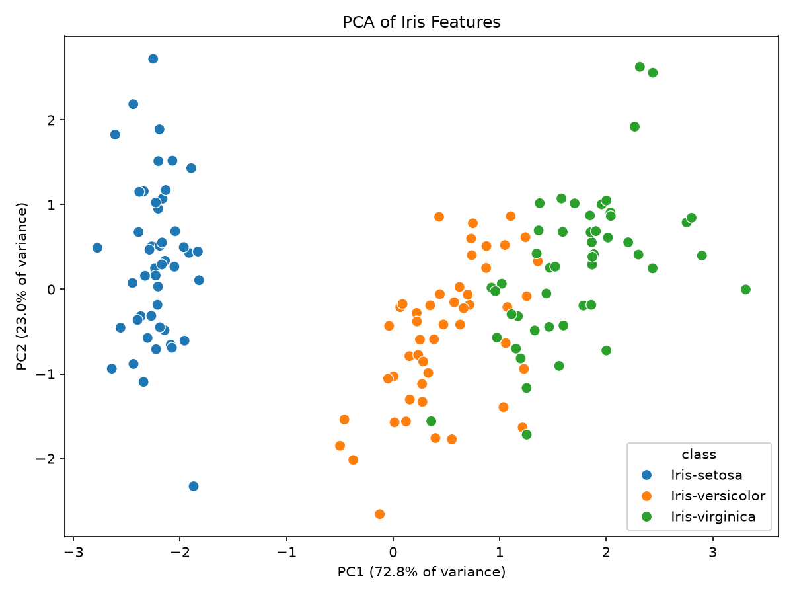

# 🌸 Iris Flower Classification App

A simple machine learning web application that predicts the **species of an Iris flower** based on its physical measurements using a trained classification model.

Built with **Python**, **scikit-learn**, and **Streamlit**.

---

## 📌 Project Overview

The Iris dataset is a classic dataset in machine learning containing measurements of iris flowers:

- Sepal length
- Sepal width
- Petal length
- Petal width

Using these features, the model predicts one of the following classes:

- **Iris-setosa**
- **Iris-versicolor**
- **Iris-virginica**

This project demonstrates the **end-to-end ML workflow**:
- Data preprocessing
- Model training & evaluation
- Model persistence
- Interactive UI deployment using Streamlit

---

## 🧠 Model Details

- **Type:** Classification
- **Algorithm:** Logistic Regression (with feature scaling)
- **Dataset:** Iris dataset
- **Evaluation Metrics:** Accuracy, Confusion Matrix, Classification Report
- **Performance:** Achieves very high accuracy due to the clean and separable nature of the dataset

---

## 🖥️ Web Application

The Streamlit app allows users to:
- Input flower measurements
- Get real-time predictions of Iris species
- Interact with the trained ML model via a simple UI

---

## 📊 Results

Running the pipeline writes the evaluation to `reports/`:

- `reports/classification_report.txt` — accuracy, precision, recall, F1, ROC-AUC, log loss and the confusion matrix
- `reports/figures/confusion_matrix.png`
- `reports/figures/pairplot.png` — every pair of features, coloured by class
- `reports/figures/pca_plot.png` — the four features projected onto two principal components

On the 30-flower test set the model classifies every flower correctly (train accuracy 96.7%).



---

## 🚀 How to Run the App Locally

### 1️⃣ Clone the repository
```bash
git clone https://github.com/LAKWAN194/iris-classification.git
cd iris-classification
```

### 2️⃣ Install dependencies
```bash
pip install -r requirements.txt
```

### 3️⃣ (Optional) Retrain the model and regenerate the reports
```bash
python run_pipeline.py
```

### 4️⃣ Run the Streamlit app
```bash
python -m streamlit run app/app.py
```

The app will open in your browser at:
```bash
http://localhost:8501
```
